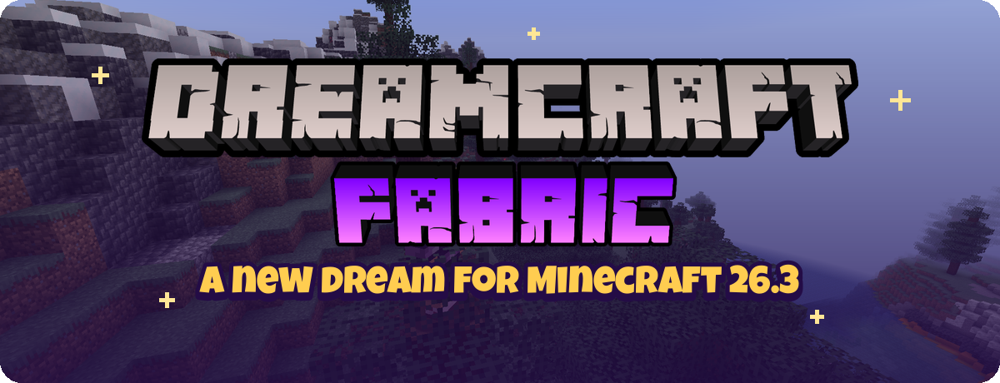
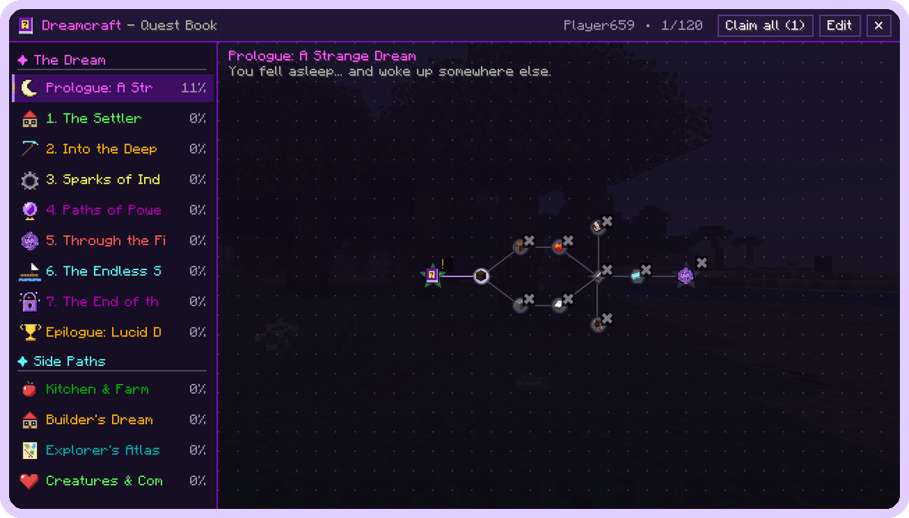
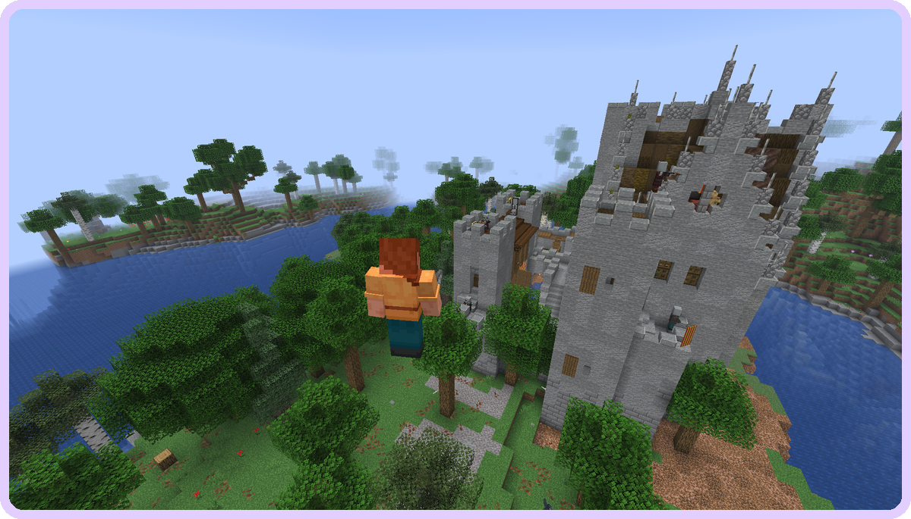
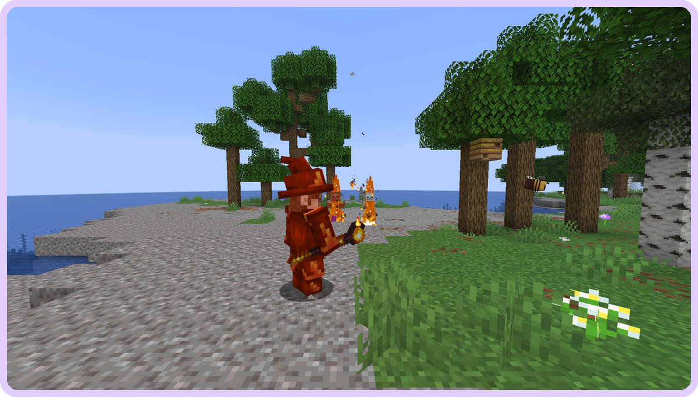
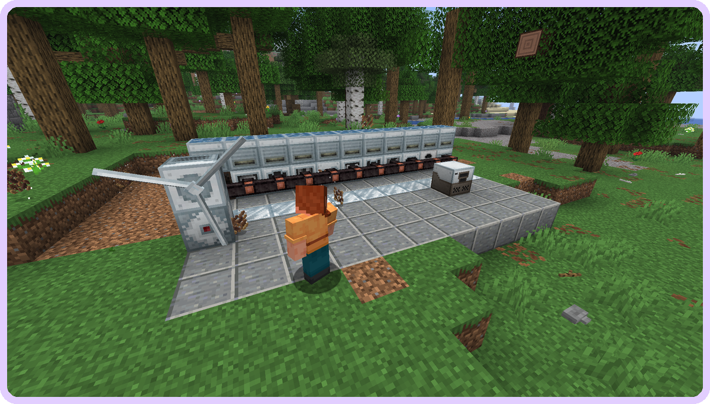
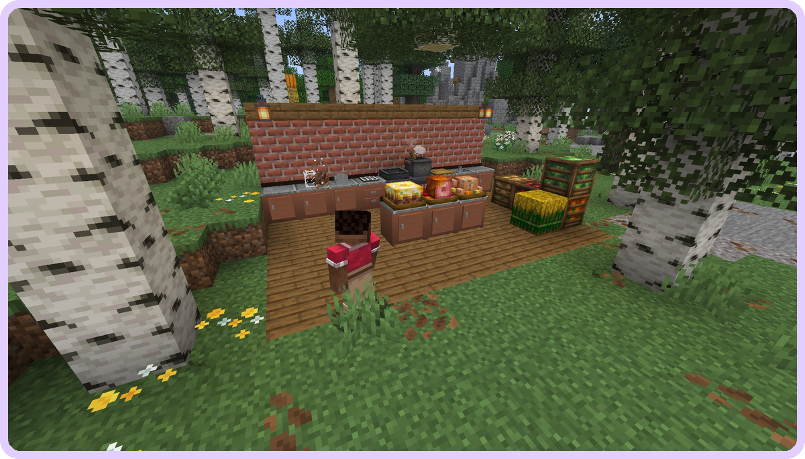
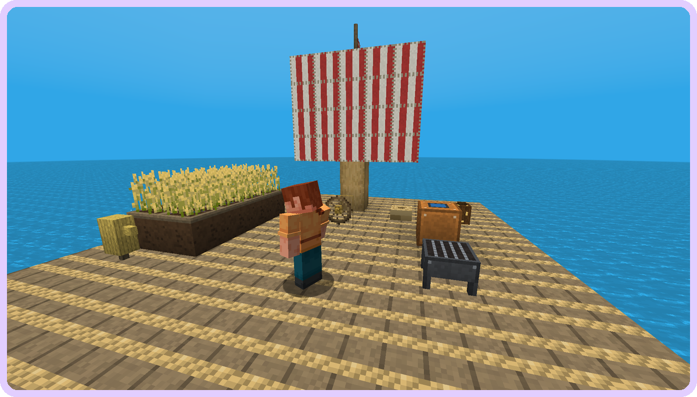
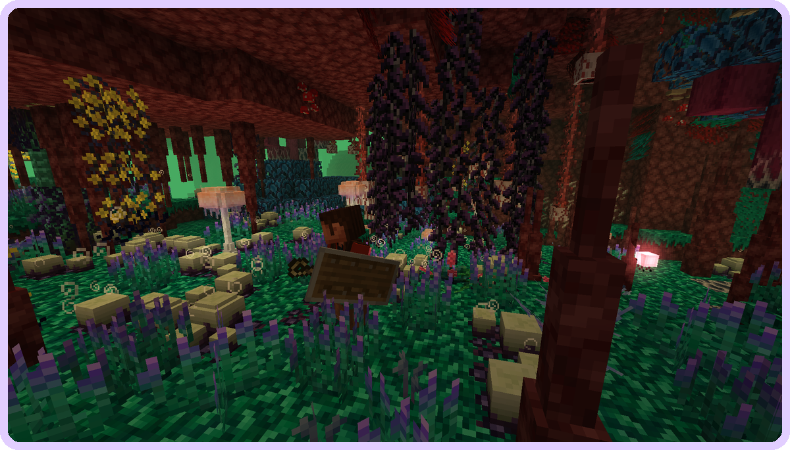

    

**Dreamcraft is back - on the newest Minecraft.** Over 250 mods turn Minecraft 26.3 into the game it could be in your dreams: new biomes and castles to explore, fire magic and paladin oaths, real cooking, machines that do the work for you, a whole ocean to survive on a raft - and a story in over 160 quests that walks you through every single mod.

Questions, ideas or bugs? Join the [Discord](https://discord.gg/zuZVtVvJaY) or open an issue on [GitHub](https://github.com/Kasax007/Modpack-Development/issues).

Want to play with your friends? Rent a ready Dreamcraft server at [BisectHosting](https://bisecthosting.com/kasax007) (at least 6 GB) - code **KASAX007** gives you **25% off** your first month. You can also open it right from the main menu ("Rent a Server").

You wake up in a strange dream. The **Dream Keeper** guides you through it - one chapter at a time, and every quest explains how the mod in it really works. Press **J** (or the book button in your inventory) to open the quest book.

- **Prologue: A Strange Dream** - your first night, your first tools
- **1. The Settler** - a home, farms, waystones, backpacks
- **2. Into the Deep** - ores, storage and the magic of enchanting
- **3. Sparks of Industry** - Tech Reborn machines, power and quarries
- **4. Paths of Power** - choose your class: wizard, paladin, archer or rogue
- **5. Through the Fire** - the overhauled Nether
- **6. The Endless Sea** - build a portal and survive on a raft (Beach Craft)
- **7. The End of the Dream** - the dragon and the new End
- **Epilogue: Lucid Dreamer** - for those who never want to wake up
- Side paths: **Kitchen & Farm**, **Builder's Dream**, **Explorer's Atlas** and **Creatures & Companions**

Rewards are useful but never broken: tools, food, XP and **loot crates** (common, rare, epic, legendary). Play in a team and share your progress with `/quests team`.

- **Terralith** and **Tectonic** - almost 100 new biomes and huge mountains, canyons and cliffs
- **Towns and Towers**, **Repurposed Structures**, **Dungeons and Taverns**, **ATi Structures**, **Structory**, **Moog's** structures, **Explorations** - castles, towers, taverns, ruins and villages everywhere
- **More Villagers**, **Better Archeology**, **Lost Relics**, **The Graveyard** - more to find, more to dig up
- **Lootr** - every player gets their own loot in each chest
- **Waystones**, **Explorer's Compass**, **Nature's Compass**, **Xaero's Minimap and World Map**, **Hang Glider**

- The **RPG Series**: **Wizards**, **Paladins & Priests**, **Archers**, **Rogues & Warriors**, **Jewelry**, **Relics**, **Arsenal** and **Armory** - spells with the **Spell Engine**, new weapons, armor and rings
- **Better Combat** and **Combat Roll** - real attack combos and dodge rolls
- **Mutant Monsters**, **Friends & Foes**, **Naturalist**, **Ecologics**, **Woodwalkers** (turn into the mobs you find!)
- **Mythic Upgrades** and **Advanced Netherite** - gear beyond netherite

- **Tech Reborn** - generators, grinders, alloy smelters, solar panels and power storage
- **Quarry Reborn** and **Additional Enchanted Miner** - quarries that dig for you
- **Storage Drawers**, **Tom's Simple Storage**, **Traveler's Backpack** - never run out of space again
- **Moving Elevators**, **Chunk Loaders**, **Item Collectors**, **Simple Magnets**, **XP Storage**, **Wireless Chargers**, **Dark Utilities**

- **Farmer's Delight** with **More Delight**, **Rustic Delight**, **Ube's Delight** and **Storage Delight** - cutting boards, cooking pots and hundreds of meals
- **Cooking for Blockheads** and **Farming for Blockheads** - a whole kitchen that cooks from everything in it
- **Right Click Harvest**, **FallingTree**, **Healing Campfire**

- All of **Macaw's** mods - roofs, windows, doors, bridges, furniture, lamps, paths, fences and paintings
- **Rechiseled**, **Dawn of Time**, **Beautify**, **Magic Vibe Decorations**, **Additional Lanterns**, diagonal fences, walls and windows
- **Effortless Building**, **Construction Wand**, **Chalk**, **Armor Statues**, **Reconnectible Chains**

Dreamcraft comes with my own **[Beach Craft](https://www.curseforge.com/minecraft/mc-mods/beach-craft)** mod, a raft survival mod: build a driftwood portal and land on a tiny raft in an endless ocean. Catch the debris that drifts by, purify water, grill fish, farm on floating crop plots - and keep your feet out of the water, because **Bruce the shark** is hungry. A whole quest chapter guides you across the sea.

**BetterNether** and **BetterEnd** rebuild both dimensions: nether jungles, mushroom forests and glowing grasslands, new mobs, new ores and new gear. Moog's Nether and End structures give you something to find out there.

- **JEI** with **Just Enough Professions** and **Just Enough Resources**, **Jade**, **AppleSkin**, **Enchantment Descriptions**
- **Inventory Profiles Next**, **Mouse Tweaks**, **Crafting Tweaks**, **Easy Anvils**, **Easy Magic**, **Enchanting Infuser**
- **Carry On**, **Mob Lassos**, **Villager in a Bucket**, **Trade Cycling**, **Trading Post**, **Death Backup**, **Forgiving Void**
- **Simple Voice Chat**, **Ping Wheel**, **Zoomify**, **Shoulder Surfing**

- **Sodium**, **Lithium**, **FerriteCore**, **ImmediatelyFast**, **Entity Culling**, **ScalableLux**, **Dynamic FPS** and more - runs smooth even with 250 mods
- **Iris** with **Complementary Reimagined** and **BSL** shaders included (off by default - turn them on under Video Settings > Shader Packs)
- **Subtle Effects**, **Falling Leaves**, **Particle Rain**, **Visuality**, **AmbientSounds**, **Sound Physics Remastered**, **Presence Footsteps**, **LambDynamicLights**, **Continuity** connected textures, **3D Skin Layers**
- A brand new main menu and loading screen in the Dreamcraft style

- **Server pack** in the files tab: unzip, run `start.sh` / `start.bat`, accept the EULA, done. Java 25 is needed.
- **RAM:** at least **6 GB**, **8 GB** recommended (more with shaders or a high render distance).
- Tested on a dedicated server: world creation, the overworld, Nether, End and the raft ocean were pre-generated with **Chunky** without errors.

---

Dreamcraft is made by Kasax007. Follow the streams on [Twitch](https://twitch.tv/Kasax007), share your best screenshots on [Discord](https://discord.gg/zuZVtVvJaY) - and have fun dreaming.
